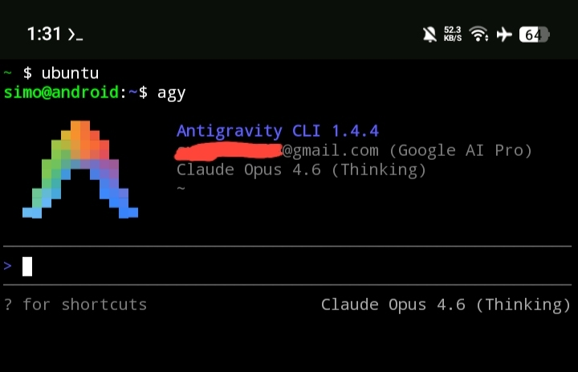

# Antigravity CLI for PRoot Ubuntu on Termux
   

A standalone package that installs the Antigravity CLI inside a PRoot
Debian/Ubuntu userland on Android.




## Origin

This package is **forked from the native Termux solution**
([wallentx/antigravity-cli-termux](https://github.com/wallentx/antigravity-cli-termux)),
which is itself a Termux port of the official
[google-antigravity/antigravity-cli](https://github.com/google-antigravity/antigravity-cli).

The native Termux build relies on the Bionic C library and on Termux' own
`glibc` package. This package keeps only the PRoot path, so the CLI runs
against the loader and shared libraries of a real Debian/Ubuntu distribution.
The full attribution chain and the licence notes are in
[CREDITS.md](CREDITS.md).

## Requirements

- An `aarch64` device. The upstream engine is only published for arm64 Linux.
- A Debian or Ubuntu userland. On Android, that is a PRoot container.
- About 300 MB of free space for the download, the build and the installed
  engine.

Native Termux works as a starting point: the installer detects it and sets up a
PRoot Ubuntu userland automatically.

## Install

### From the package archive

```sh
unzip antigravity-cli-proot.zip
cd antigravity-cli-proot
bash install.sh
```

### From native Termux

The installer installs `proot-distro` if needed, creates the Ubuntu userland,
enters it and continues there:

```sh
pkg install proot-distro
bash install.sh
```

The Termux filesystem is visible from within PRoot, so a package unpacked in
Termux is found at the same path inside the container.

### With modded-ubuntu

[modded-ubuntu](https://github.com/modded-ubuntu/modded-ubuntu) is a prebuilt
PRoot Ubuntu 26.04 image for Termux, with an optional XFCE4 desktop. It
registers its container with `proot-distro` under the name `ubuntu`, so the
installer detects it and continues inside that userland:

```sh
git clone --depth=1 https://github.com/modded-ubuntu/modded-ubuntu.git
cd modded-ubuntu && bash setup.sh
```

Afterwards run `bash install.sh` from Termux as above. Any other Debian or
Ubuntu PRoot container works the same way.

### Options

```
--prefix DIR     Install the binaries into DIR (default: /usr/local/bin)
--no-launch      Do not start the CLI after the installation
--keep-staging   Keep the temporary build directory for inspection
--uninstall      Remove a previous installation
```

Environment variables: `AGY_PREFIX`, `AGY_ENGINE_URL`, `AGY_ENGINE_FILE`,
`AGY_MANIFEST_URL`, `AGY_PROOT_DISTRO`, `AGY_SKIP_DEPS`, `AGY_FORCE_DEPS`.

## Usage

```sh
agy                                          # interactive TUI
agy --print "explain this in three lines"   # single prompt, no UI
agy update                                   # check for a newer engine
agy --help                                   # full command list
```

The first run opens a browser for the Google account login; the credentials are
then stored in `~/.gemini/antigravity-cli/`.

## How it works

The upstream engine is an `aarch64` Linux binary that assumes a 48-bit virtual
address space. Android userlands provide only 39 bits, so the engine's
allocator aborts at start-up. The installer therefore:

1. downloads the engine from Google's official release manifest,
2. verifies it against the published SHA-512 checksum,
3. patches it for the 39-bit address space (the "VA39" patches),
4. compiles a bootstrapper against the glibc of the surrounding distribution,
5. installs both files and verifies that they run.

The patches rewrite the ARM64 instructions that TCMalloc uses to compute
aligned mapping addresses, and stub the `faccessat2` wrapper so it stays
available on older kernels. They are implemented in C inside the bootstrapper
(`src/agy_proot.c`) and, as an independent reference, in Python
(`src/patch_va39.py`); both produce byte-identical output. If the upstream
layout changes and no patch site is found any more, the patcher fails loudly
instead of installing a broken engine.

The result is the twin-binary layout the native Termux port uses:

| File | Role |
| :--- | :--- |
| `agy` | Bootstrapper. Locates the glibc loader, sanitises the environment and starts the engine. |
| `agy.va39` | The upstream engine with the VA39 memory patches applied. |
| `.agy.version` | The installed engine version, used by the self-updater. |

## Updating

`agy update` queries the official manifest, compares the published version with
the installed one, downloads the new engine, verifies its SHA-512 checksum,
applies the VA39 patches again and replaces the installed pair. The update is
transactional: if the new engine does not start, the previous installation is
restored. The same check runs once at start-up. Set `AGY_AUTO_UPDATE=1` to
apply updates without a prompt, or `AGY_UPDATE_DEBUG=1` to show start-up check
errors.

## Uninstalling

```sh
bash install.sh --uninstall
```

Removes `agy`, `agy.va39` and `.agy.version` from the install directory. The
stored Google credentials are left untouched.

## Known limitations

- **Architecture.** Only `aarch64` is supported. Google publishes no arm64
  engine for other architectures and the VA39 patches are ARM64 specific.
- **Network.** The engine needs HTTPS access to the Google release service for
  updates and to the Google login endpoints for authentication. Inside PRoot the
  resolver configuration in `/etc/resolv.conf` must be present.

## Files in this package

```
antigravity-cli-proot/
├── README.md              this file
├── CREDITS.md             attribution chain and licence notes
├── VERSION                package version
├── install.sh             installer
├── uninstall.sh           removal helper
├── .clang-format          style used for the C source
├── .clang-tidy            static analysis rules used for the C source
├── assets/
│   └── screenshot.png     screenshot used above
└── src/
    ├── agy_proot.c        bootstrapper and VA39 patcher
    └── patch_va39.py      reference implementation of the patcher
```

## Credits

- The Antigravity CLI is developed by Google:
  [google-antigravity/antigravity-cli](https://github.com/google-antigravity/antigravity-cli).
- The native Termux standalone port is by
  [wallentx](https://github.com/wallentx):
  [wallentx/antigravity-cli-termux](https://github.com/wallentx/antigravity-cli-termux).
- The PRoot Ubuntu userland used for testing is
  [modded-ubuntu](https://github.com/modded-ubuntu/modded-ubuntu) (Apache-2.0),
  which builds on the [proot-distro](https://github.com/termux/proot-distro)
  rootfs.
- This PRoot-only package was derived from the native Termux port.

See [CREDITS.md](CREDITS.md) for the full attribution chain.

**Dev:** Simo